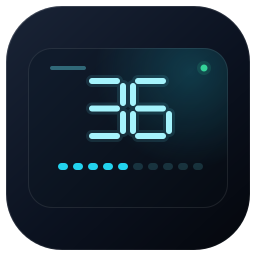
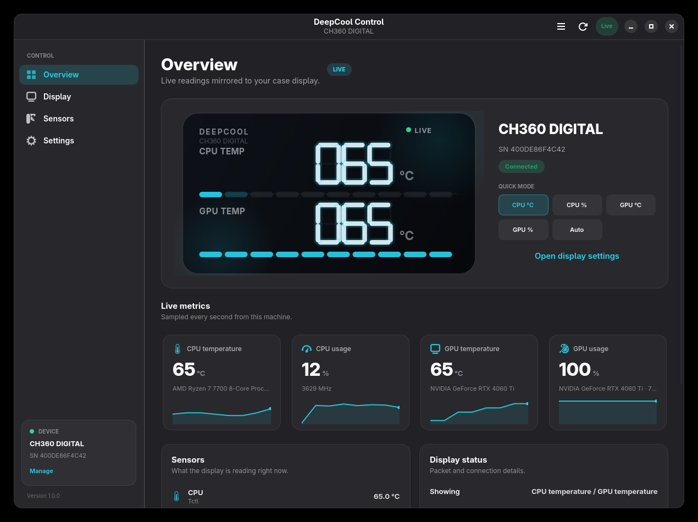

# DeepCool Control



Native GTK4/libadwaita application for DeepCool CH-series digital case
displays. It reads CPU and GPU sensors locally and drives the two three-digit
readouts and ten-cell load bars over USB HID.



> **Independent project.** DeepCool Control is not affiliated with, endorsed by,
> or supported by DeepCool. DeepCool and its product names are trademarks of
> their respective owners. Use this software at your own risk.

The application controls the digital readout only. Case fan and ARGB lighting
are outside its scope. It does not make network requests and does not require a
browser runtime.

## Supported hardware

| Device | USB ID | Status |
|---|---|---|
| CH360 DIGITAL | `3633:0015` | Supported; used as the reference device |
| CH560 DIGITAL | `3633:0005` | Same 64-byte protocol; not hardware-verified |
| MORPHEUS | `3633:0007` | Same 64-byte protocol; not hardware-verified |

Only known CH-series product IDs are opened. Other DeepCool USB devices are
detected but never written to.

## Install

### Prebuilt packages

CI publishes an RPM, a DEB, `SHA256SUMS`, and `BUILD-INFO.txt` for every push to
`main` as a pre-release snapshot. Download the assets from the repository's
Releases page and verify them before installing:

```bash
sha256sum -c SHA256SUMS
```

#### Fedora, RHEL, and compatible RPM distributions

```bash
sudo dnf install ./deepcool-control-*.rpm
```

If `dnf` is unavailable:

```bash
sudo rpm -i ./deepcool-control-*.rpm
```

#### Debian, Ubuntu, Linux Mint, and compatible DEB distributions

```bash
sudo apt install ./deepcool-control_*.deb
```

If `apt` is unavailable:

```bash
sudo dpkg -i ./deepcool-control_*.deb
sudo apt-get -f install
```

Both packages install the application, desktop entry, icon, and the hidraw
permission rule.

### From source

The source launcher does not require installation:

```bash
./deepcool-control               # GUI
./deepcool-control --simulate    # demo mode, no hardware access
./deepcool-control --doctor      # diagnostics
./deepcool-control --list        # devices and sensor sources
./deepcool-control --daemon      # headless updater
```

Per-user install:

```bash
./install.sh
./install.sh --udev   # optional: install the hidraw permission rule
deepcool-control
```

This installs the application under `~/.local/lib/deepcool-control` and the
launcher under `~/.local/bin/deepcool-control`.

System-wide install:

```bash
sudo ./install.sh --system
```

This installs under `/usr/local` and installs the udev rule. Remove it with
`sudo ./uninstall.sh --system`.

## Requirements

- Linux with Python 3.11+
- GTK 4.14+ and libadwaita 1.5+
- GObject Introspection bindings for GTK 4 and libadwaita
- `python3-psutil`
- Optional: `nvidia-smi` for NVIDIA GPU sensors

Fedora:

```bash
sudo dnf install python3-gobject gtk4 libadwaita python3-psutil
```

Debian/Ubuntu:

```bash
sudo apt install python3-gi gir1.2-gtk-4.0 gir1.2-adw-1 python3-psutil
```

## Usage

The main window has four pages:

- **Overview** — live preview, quick mode controls, and current CPU/GPU metrics.
- **Display** — primary and secondary readout modes, units, refresh interval,
  and auto-cycle interval.
- **Sensors** — CPU temperature source, GPU selection, and other hardware
  sensors. **Rescan** refreshes the hardware list.
- **Settings** — colour scheme, accent colour, preview animation, autostart,
  background service, permissions, and diagnostics.

Keyboard shortcuts:

| Shortcut | Action |
|---|---|
| `Ctrl+1` … `Ctrl+4` | Switch pages |
| `Ctrl+,` | Open Settings |
| `Ctrl+R` | Send the current reading immediately |
| `F1` | About |
| `Ctrl+Q` | Quit |

### Background service

The display is driven by status packets, not by the GUI. Enable
**Settings → Background service** to keep it updated after the window is closed.
The service is a systemd user unit with `Restart=always` and no restart limit.

```bash
systemctl --user status deepcool-control
journalctl --user -u deepcool-control -f
```

Settings changed in the window are picked up by the service within a few
seconds. If the service owns the display, the window shows a **Service** status;
use **Take over** only when you want the GUI to control the device directly.

To keep the service running before login and after logout, enable lingering:

```bash
loginctl enable-linger "$USER"
```

To stop and disable it:

```bash
systemctl --user disable --now deepcool-control
loginctl disable-linger "$USER"
```

The panel has no independent power state. It stays lit only while the PC is
powered and the USB cable is connected.

## Configuration

Configuration is stored in `~/.config/deepcool-control/config.json`. The file is
validated on load; unknown or invalid values fall back to safe defaults rather
than preventing startup.

| Key | Default | Values |
|---|---|---|
| `primary` | `cpu_temp` | `cpu_temp`, `cpu_usage`, `auto` |
| `secondary` | `gpu_temp` | `gpu_temp`, `gpu_usage`, `auto`, `off` |
| `fahrenheit` | `false` | boolean |
| `interval_ms` | `1000` | 250–5000 |
| `auto_cycle_s` | `10` | 3–120 |
| `cpu_sensor` | auto-detect | hwmon sensor ID |
| `gpu_sensor` | auto-detect | GPU ID |
| `accent` | `cyan` | `cyan`, `violet`, `emerald`, `amber`, `rose`, `blue` |
| `color_scheme` | `system` | `system`, `light`, `dark` |
| `animations` | `true` | boolean |
| `autostart` | `false` | boolean |

`auto` alternates between temperature and utilisation using `auto_cycle_s`.
`primary` and `secondary` cycle independently.

## Build packages

The packaging scripts read the version from `pyproject.toml` and write artifacts
to `dist/`. The directory is intentionally not tracked; release assets are built
by CI.

Build both packages:

```bash
./packaging/build-all.sh
```

Build the RPM (requires `rpm-build`):

```bash
sudo dnf install rpm-build
./packaging/build-rpm.sh
```

Build the DEB (uses `dpkg-deb` when available, with a portable `ar` fallback):

```bash
./packaging/build-deb.sh
```

Standard Debian packaging files are available in `debian/` for users who prefer
`dpkg-buildpackage`.

### Continuous integration

Every push to `main` runs the test suite, builds the RPM in a Fedora 44
container and the DEB in a Debian 12 container, then publishes a pre-release
tagged `snapshot-<short-commit>`. The release contains both packages,
`SHA256SUMS`, and `BUILD-INFO.txt`. Failed tests block the release.
`pyproject.toml` is the source of truth for the package version; snapshot tags
identify the exact commit independently of that version.

## Architecture

```text
src/deepcool_control/
├── protocol.py     64-byte CH-series HID report encoder
├── device.py       hidraw discovery, locking, safe writes
├── sensors.py      hwmon, psutil, nvidia-smi and DRM sampling
├── controller.py   GTK controller, scheduling and state
├── daemon.py       headless systemd updater
├── system.py       autostart, user service and udev integration
├── app.py          CLI and Adw.Application
└── ui/
    ├── window.py       shell, sidebar and navigation
    ├── dashboard.py    overview page
    ├── display_page.py readout configuration
    ├── sensors_page.py sensor source selection
    ├── settings_page.py appearance and integration
    ├── widgets.py      Cairo preview, sparklines and cards
    └── style.css       Adwaita companion stylesheet
```

### HID packet layout

The display accepts one 64-byte output report:

| Byte | Meaning |
|---|---|
| `0` | Report ID `0x10` |
| `1` | Primary mode: `19` = °C, `35` = °F, `76` = % |
| `2` | Primary bar, 1–10 cells |
| `3..5` | Primary digits, hundreds/tens/ones |
| `6` | Secondary mode: same values, `0` = off |
| `7` | Secondary bar, 1–10 cells |
| `8..10` | Secondary digits |
| `11..63` | Zero padding |

Writing mode `170` in byte 1 once performs the panel start-up animation. Bars
show at least one cell below 15 % utilisation and otherwise round to the nearest
of ten cells; the encoder matches the firmware's round-half-away-from-zero
behaviour.

## Development

```bash
python3 -m unittest discover -s tests -v
python3 -m compileall -q src
bash -n install.sh uninstall.sh packaging/*.sh
./deepcool-control --simulate
```

Demo mode (`--simulate` or `DEEPCOOL_DEMO=1`) uses simulated hardware so the UI
can be developed without device permissions.

## Troubleshooting

**The display shows “Permission”** — install the udev rule, reconnect the
display, and run `deepcool-control --doctor`. On some systems the ACL is applied
only after replugging or signing in again.

**The display shows “Service”** — the systemd user service owns the display. Use
**Take over** in the sidebar, or disable the background service in Settings.

**No supported display found** — run `deepcool-control --list` and check the USB
PID. Only CH360, CH560, and MORPHEUS use this protocol.

**The vendor application is also running** — close it before using DeepCool
Control. Two processes cannot safely drive the same HID report stream.

**NVIDIA readings are missing** — install the proprietary driver tools so
`nvidia-smi` is available, then press **Rescan** on the Sensors page.

**The display turns off when the window closes** — enable the background service
and verify it is active with `systemctl --user status deepcool-control`.

## License

MIT — see [LICENSE](LICENSE).
