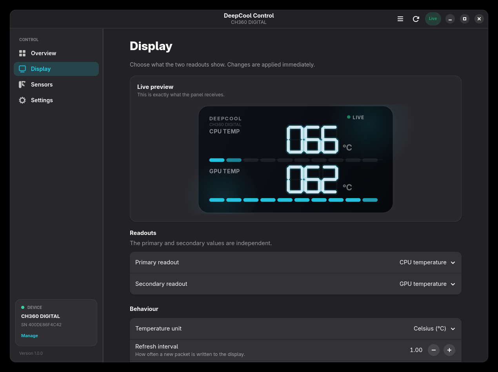
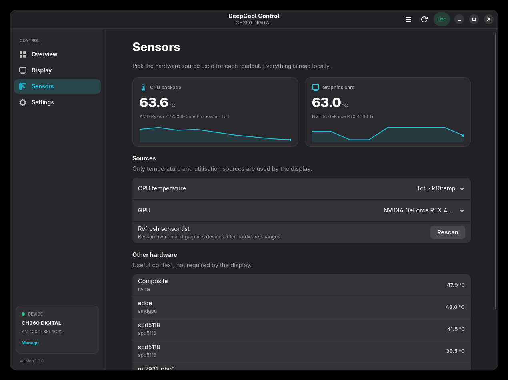
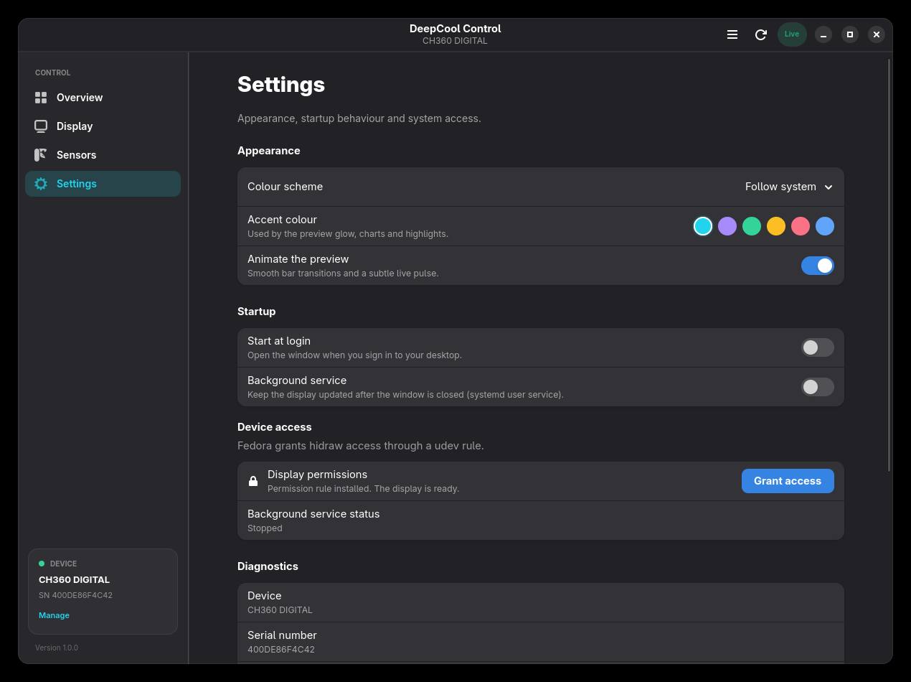

# DeepCool Linux


A native **GTK4 / libadwaita** Linux application for DeepCool CH-series digital
case displays. It reads hardware sensors locally and mirrors them to the two
three-digit readouts and ten-cell load bars over USB HID.

This is an independent Linux alternative to the display-control software
available on the official
[DeepCool download page](https://www.deepcool.com/downloadpage/). It is built
for Linux desktops, with no Electron runtime, no background web view, and no
telemetry.


> **Educational project:** DeepCool Linux is not affiliated with, endorsed by,
> or supported by DeepCool. Product names and trademarks belong to their
> respective owners. Use it at your own risk.

## Download and install

Prebuilt packages are included in `dist/`. Choose the package for your
distribution. Checksums are available in `dist/SHA256SUMS`; verify them with:

```bash
cd dist
sha256sum -c SHA256SUMS
```

### Fedora, RHEL, and compatible RPM distributions

```bash
sudo dnf install ./dist/deepcool-control-*.rpm
```

The package installs the application, desktop entry, icon, and udev permission
rule. If your distribution does not use `dnf`, install the RPM directly:

```bash
sudo rpm -i ./dist/deepcool-control-*.rpm
```

### Debian, Ubuntu, Linux Mint, and compatible DEB distributions

```bash
sudo apt install ./dist/deepcool-control_*.deb
```

The package installs the application, desktop entry, icon, and udev permission
rule. On distributions without `apt`, use:

```bash
sudo dpkg -i ./dist/deepcool-control_*.deb
sudo apt-get -f install
```

### Run from the source tree

No package installation is required for development:

```bash
./deepcool-control               # GUI
./deepcool-control --simulate    # demo mode, no hardware access
./deepcool-control --doctor      # diagnostics
./deepcool-control --list        # devices and sensor sources
./deepcool-control --daemon      # headless updater
```

### Per-user install

```bash
./install.sh
./install.sh --udev   # optional: install the hidraw permission rule
deepcool-control
```

The per-user install places the application in `~/.local/lib/deepcool-control`
and the launcher in `~/.local/bin/deepcool-control`.

### System-wide install from source

```bash
sudo ./install.sh --system
```

This installs under `/usr/local` and installs the udev rule. Uninstall with
`sudo ./uninstall.sh --system`.

## Features

- **Hardware-accurate live preview** — seven-segment digits, unit, and ten-cell
  bars are drawn exactly as the panel receives them.
- **Two independent readouts** — CPU temperature/utilisation for the primary
  readout; GPU temperature/utilisation, auto cycle, or off for the secondary.
- **Independent auto cycle** — the primary and secondary readouts can each
  alternate between temperature and utilisation on a configurable interval.
- **Celsius or Fahrenheit** — with the same truncation behaviour as the
  reference firmware.
- **Adjustable refresh rate** — 0.25 s to 5 s.
- **Sensor source selection** — choose the CPU temperature source (Tctl, Tccd,
  package) and the discrete or integrated GPU.
- **Live metrics** — CPU/GPU temperature and load, clock speed, memory use, NVMe
  and other sensor readings, with sparklines.
- **Native integration** — GNOME colour schemes, accent colours, systemd user
  service, XDG autostart, desktop entry, and a udev permission helper.
- **Safe device handling** — only known CH-series PIDs are opened, and an
  advisory lock prevents the GUI and the background service from writing to the
  same display at the same time.

| Overview | Display |
|---|---|
|  |  |

| Sensors | Settings |
|---|---|
|  |  |

## Supported hardware

| Product | USB PID | Status |
|---|---|---|
| CH360 DIGITAL | `3633:0015` | Supported and used as the reference device |
| CH560 DIGITAL | `3633:0005` | Same 64-byte CH-series protocol |
| MORPHEUS | `3633:0007` | Same 64-byte CH-series protocol |

Other DeepCool USB products are detected and displayed as unsupported; the app
will never send them an unknown packet.

## Requirements

- Linux with Python 3.11+
- GTK 4.14+ and libadwaita 1.5+
- GObject Introspection bindings for GTK 4 and libadwaita
- `python3-psutil`
- Optional: `nvidia-smi` for NVIDIA GPU sensors

Fedora:

```bash
sudo dnf install python3-gobject gtk4 libadwaita python3-psutil
```

Debian/Ubuntu:

```bash
sudo apt install python3-gi gir1.2-gtk-4.0 gir1.2-adw-1 python3-psutil
```

## Build packages from source

The packaging scripts use the version in `pyproject.toml` and write artifacts
to `dist/`.

### Build both packages

```bash
./packaging/build-all.sh
```

### Build the RPM

```bash
sudo dnf install rpm-build
./packaging/build-rpm.sh
```

### Build the DEB

The DEB builder works on any Linux host. It uses `dpkg-deb` when available and
a portable `ar`-based fallback otherwise.

```bash
./packaging/build-deb.sh
```

Standard Debian packaging files are also provided in `debian/` for users who
prefer `dpkg-buildpackage`.

## Device permissions

Linux exposes the display as `/dev/hidrawN` owned by `root:root` with mode
`0600`. The included udev rule grants the active desktop session access through
`TAG+="uaccess"`:

```udev
SUBSYSTEM=="hidraw", ATTRS{idVendor}=="3633", TAG+="uaccess", MODE="0660"
```

The RPM and DEB packages install and activate this rule. For a source install,
use either of these:

```bash
./install.sh --udev
```

or open **Settings → Display permissions → Grant access** in the app. The app
uses PolicyKit (`pkexec`) to install the rule and reload udev. Reconnect the
display if it was already plugged in, then verify:

```bash
deepcool-control --doctor
```

The doctor output should show `writable=True` for the supported display.

## Using the app

- **Overview** shows the live panel preview, quick mode chips, and all live
  metrics.
- **Display** controls the primary/secondary readout, units, refresh interval,
  and auto-cycle interval.
- **Sensors** selects the CPU temperature source and GPU, and lists other
  hardware sensors. **Rescan** picks up hardware changes.
- **Settings** controls the colour scheme, accent colour, preview animation,
  autostart, background service, permissions, and diagnostics.

Keyboard shortcuts:

| Shortcut | Action |
|---|---|
| `Ctrl+1` … `Ctrl+4` | Switch pages |
| `Ctrl+,` | Settings |
| `Ctrl+R` | Send the current reading immediately |
| `F1` | About |
| `Ctrl+Q` | Quit |

The background service can be enabled under **Settings → Background service**.
It writes packets through the same protocol and lock, so it can keep the display
updated after the window is closed. If the service holds the display, the window
shows a **Service** status and offers **Take over** in the sidebar. Settings
changed in the window are picked up by the service within a few seconds.

### Keep the display on 24/7

The panel has no independent power state: it stays lit while the daemon keeps
sending status packets. Enable **Settings → Background service** so closing the
window does not turn the display off. The generated systemd user unit restarts
automatically and has no restart limit.

To keep the service running before login and after logout, enable lingering for
your account:

```bash
loginctl enable-linger "$USER"
```

## How it works

```
src/deepcool_control/
├── protocol.py     64-byte CH-series HID report encoder
├── device.py       hidraw discovery, locking, safe writes
├── sensors.py      hwmon, psutil, nvidia-smi and DRM sampling
├── controller.py   GTK controller, scheduling and state
├── daemon.py       headless systemd updater
├── system.py       autostart, user service and udev integration
├── app.py          CLI and Adw.Application
└── ui/
    ├── window.py       shell, sidebar and navigation
    ├── dashboard.py    overview page
    ├── display_page.py readout configuration
    ├── sensors_page.py sensor source selection
    ├── settings_page.py appearance and integration
    ├── widgets.py      Cairo preview, sparklines and cards
    └── style.css       Adwaita companion stylesheet
```

### HID packet layout

The CH-series display accepts one 64-byte output report:

| Byte | Meaning |
|---|---|
| `0` | Report ID `0x10` |
| `1` | Primary mode: `19` = °C, `35` = °F, `76` = % |
| `2` | Primary bar, 1–10 cells |
| `3..5` | Primary digits, hundreds/tens/ones |
| `6` | Secondary mode: same values, `0` = off |
| `7` | Secondary bar, 1–10 cells |
| `8..10` | Secondary digits |
| `11..63` | Zero padding |

Writing mode `170` in byte 1 once performs the panel start-up animation. Bars
show at least one cell below 15 % utilisation and otherwise round to the nearest
of ten cells; the encoder matches the firmware's round-half-away-from-zero
behaviour.

## Development

```bash
python3 -m unittest discover -s tests -v
python3 -m compileall -q src
./deepcool-control --simulate
```

Demo mode (`--simulate` or `DEEPCOOL_DEMO=1`) uses simulated hardware so the UI
can be developed without device permissions.

Configuration is stored in `~/.config/deepcool-control/config.json`. The app
validates the file on load and falls back to defaults rather than failing to
start.

## Troubleshooting

**The display shows "Permission"** — install the udev rule, reconnect the
display, and run `--doctor`. On some systems the ACL is applied only after
replugging or signing in again.

**The display shows "Service"** — the systemd user service owns the display.
Use **Take over** in the sidebar, or disable the background service in Settings.

**No supported display found** — run `deepcool-control --list` and check the USB
PID. Only CH360/CH560/MORPHEUS use this protocol.

**The vendor app is also installed** — close it before using DeepCool Linux.
Two processes cannot safely drive the same HID report stream.

**NVIDIA readings are missing** — install the proprietary driver tools so
`nvidia-smi` is available, then press **Rescan** on the Sensors page.

## Educational purpose

DeepCool Linux is an educational and interoperability project. It demonstrates
how to build a native Linux hardware application with GTK4, hwmon, psutil,
hidraw, udev, systemd user services, and distribution packaging. The project is
independent and is not an official DeepCool product.

DeepCool and the names of its products are trademarks of their respective
owners. All trademarks are used only to describe hardware compatibility.

## License

MIT — see [LICENSE](LICENSE).
